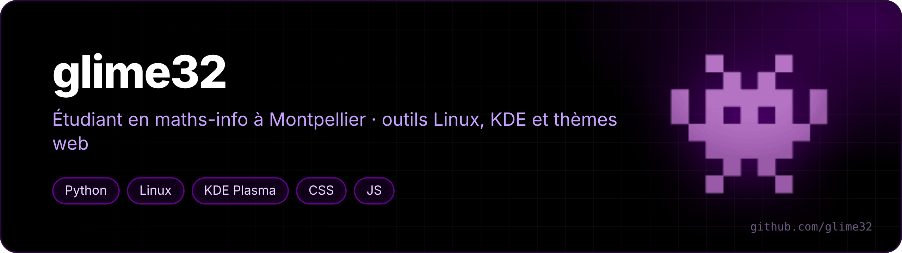

Salut 👋 Je suis étudiant en L1 double licence maths-info à l'Université de Montpellier. J'aime bien bricoler mon Linux (CachyOS + KDE Plasma sur un Lenovo Yoga 7 2-in-1) jusqu'à ce qu'il fasse exactement ce que je veux, et tout passer en noir OLED + violet.

*Hi! First-year maths & computer science student in Montpellier, France. I tinker with Linux and KDE Plasma, and theme everything OLED black + purple.*

## 🖼️ En images

<table>
<tr>
<td width="50%"> <b>claude-usage-plasma</b> · usage Claude, watts et température dans la barre KDE</td>
<td width="50%"> <b>helium-theme-oled-violet</b> · Helium tout noir + violet</td>
</tr>
<tr>
<td> <b>claude-launcher-kde</b> · mes conversations Claude Code, une couleur par fenêtre</td>
<td> <b>revisions-s1</b> · mon site de révisions (ordi et téléphone)</td>
</tr>
<tr>
<td> <b>nouvel-onglet-cours</b> · mes cours Moodle dans chaque nouvel onglet</td>
<td> <b>chess-trainer</b> · Stockfish sur la position copiée</td>
</tr>
<tr>
<td> <b>pendule-chaos</b> · un double pendule par pixel : la carte du chaos</td>
<td> <b>reaction-diffusion</b> · Gray-Scott en direct dans le terminal</td>
</tr>
</table>

## 🧮 Algorithmes et maths

Des classiques de l'informatique écrits de zéro, en C, Rust, Python et SQL.

| Projet | |
|---|---|
| [**qr-a-la-main**](https://github.com/glime32/qr-a-la-main) | QR codes générés de zéro, sans dépendance : Reed-Solomon, masques, vérifiés avec zbarimg (Rust) |
| [**cdcl-sat**](https://github.com/glime32/cdcl-sat) | Solveur SAT moderne : sudoku, n reines, pigeons, transition de phase du 3-SAT (Rust) |
| [**degonfle**](https://github.com/glime32/degonfle) | gzip réécrit de zéro, compatible avec le vrai et aussi compact (Rust) |
| [**pendule-chaos**](https://github.com/glime32/pendule-chaos) | Un double pendule par pixel : cartes du chaos, exposants de Lyapunov (C) |
| [**reaction-diffusion**](https://github.com/glime32/reaction-diffusion) | Gray-Scott en direct dans le terminal, on fait pousser des motifs à la souris (C) |
| [**pavages-dlx**](https://github.com/glime32/pavages-dlx) | Tous les pavages de pentaminos et du cube Soma, avec l'algorithme X de Knuth (C) |
| [**spectrogramme-secret**](https://github.com/glime32/spectrogramme-secret) | Une image cachée dans un son, qui réapparaît dans le spectrogramme (C) |
| [**bytebeat-jit**](https://github.com/glime32/bytebeat-jit) | De la musique en une formule, compilée à la volée en code machine x86-64 (C) |
| [**bombe-enigma**](https://github.com/glime32/bombe-enigma) | Enigma et la bombe de Turing : tout le réglage retrouvé à partir d'un mot deviné (Python) |
| [**circuit-spice**](https://github.com/glime32/circuit-spice) | Simulateur de circuits façon SPICE : analyse nodale, diodes, diagrammes de Bode (Python) |
| [**lambda-tromp**](https://github.com/glime32/lambda-tromp) | Le λ-calcul pur, dessiné en diagrammes de Tromp (Python) |
| [**lutece**](https://github.com/glime32/lutece) | Un petit langage aux mots-clés français, compilé en assembleur x86-64 (Python) |
| [**sql-de-la-vie**](https://github.com/glime32/sql-de-la-vie) | Le Jeu de la vie écrit entièrement en SQL (SQLite) |

## 🐧 Linux / KDE Plasma

| Projet | |
|---|---|
| [**battrack**](https://github.com/glime32/battrack) | Ce qui vide la batterie, appli par appli et onglet par onglet (C, sans root) |
| [**kde-econome**](https://github.com/glime32/kde-econome) | La batterie ménagée toute seule : Bluetooth coupé s'il ne sert pas, écran à 60 Hz sur batterie, plafond de charge remis, Performance oublié quitté (Rust) |
| [**palm-guard**](https://github.com/glime32/palm-guard) | Rejet de paume pour écran tactile sous Wayland, pour dessiner au stylet dans Xournal++ (Rust) |
| [**kde-tablette-outils**](https://github.com/glime32/kde-tablette-outils) | Mode tablette sur un 2-en-1 : clavier, pavé et touches Fn coupés, clavier virtuel, menu d'un glissé depuis le bas (Rust) |
| [**zoom-veille**](https://github.com/glime32/zoom-veille) | Ferme Zoom quand il tourne pour rien dans le tray (Rust) |
| [**vesktop-tray-icon**](https://github.com/glime32/vesktop-tray-icon) | Ton icône KDE perso aussi dans le tray de Vesktop |
| [**detecteur-mouvement-wayland**](https://github.com/glime32/detecteur-mouvement-wayland) | Détection de mouvement à l'écran sous Wayland (portail XDG, PipeWire, PyQt6) |

## 🤖 Claude Code

| Projet | |
|---|---|
| [**claude-usage-plasma**](https://github.com/glime32/claude-usage-plasma) | Usage Claude (session et semaine), watts et température dans la barre KDE, notifs PC et téléphone |
| [**claude-launcher-kde**](https://github.com/glime32/claude-launcher-kde) | Tape « claude » dans le menu KDE : reprendre une conversation ou en créer une titrée, une couleur par fenêtre, notifs quand Claude a fini (Rust) |
| [**clic**](https://github.com/glime32/clic) | Skill qui permet à Claude de cliquer et de regarder l'écran sous Wayland, pour tester une interface lui-même |

## 🎨 Thèmes et navigateur

| Projet | |
|---|---|
| [**helium-theme-oled-violet**](https://github.com/glime32/helium-theme-oled-violet) | Helium tout noir OLED + violet, pages internes comprises, mis à jour tout seul |
| [**stylus-magique**](https://github.com/glime32/stylus-magique) | Le style de ma page Nouvel onglet sur 278 domaines : noir OLED, violet et bleu, titres Gloock |
| [**soundcloud-mobile**](https://github.com/glime32/soundcloud-mobile) | SoundCloud façon Spotify sur téléphone, sans pub ni appli |
| [**pdf-moodle-restore**](https://github.com/glime32/pdf-moodle-restore) | Rouvre les PDF Moodle après un redémarrage du navigateur : reconnexion CAS automatique (ENT Montpellier) |

## 🎓 Études

| Projet | |
|---|---|
| [**revisions-s1**](https://github.com/glime32/revisions-s1) | Mon site de révisions du S1 : leçons pas à pas, cartes, programme du jour ([ouvrir](https://glime32.github.io/revisions-s1/)) |
| [**nouvel-onglet-cours**](https://github.com/glime32/nouvel-onglet-cours) | Nouvel onglet avec mes raccourcis, mes cours Moodle en cartes et un mode révision (séances 25/5, sites en pause) |

## 🎮 Jeux

| Projet | |
|---|---|
| [**coc-alarmes**](https://github.com/glime32/coc-alarmes) | Fins d'améliorations Clash of Clans → alarmes sur le téléphone et Google Agenda, boosts compris (PyQt6) |
| [**bot-coc**](https://github.com/glime32/bot-coc) | Boucle d'attaques Clash of Clans par reconnaissance d'image (OpenCV + ADB + scrcpy) |
| [**chess-trainer**](https://github.com/glime32/chess-trainer) | Petite fenêtre Stockfish pour analyser la position copiée (FEN / PGN) |
| [**mc-recup-inventaire**](https://github.com/glime32/mc-recup-inventaire) | Récupère ton inventaire depuis la sauvegarde d'un serveur Minecraft |

